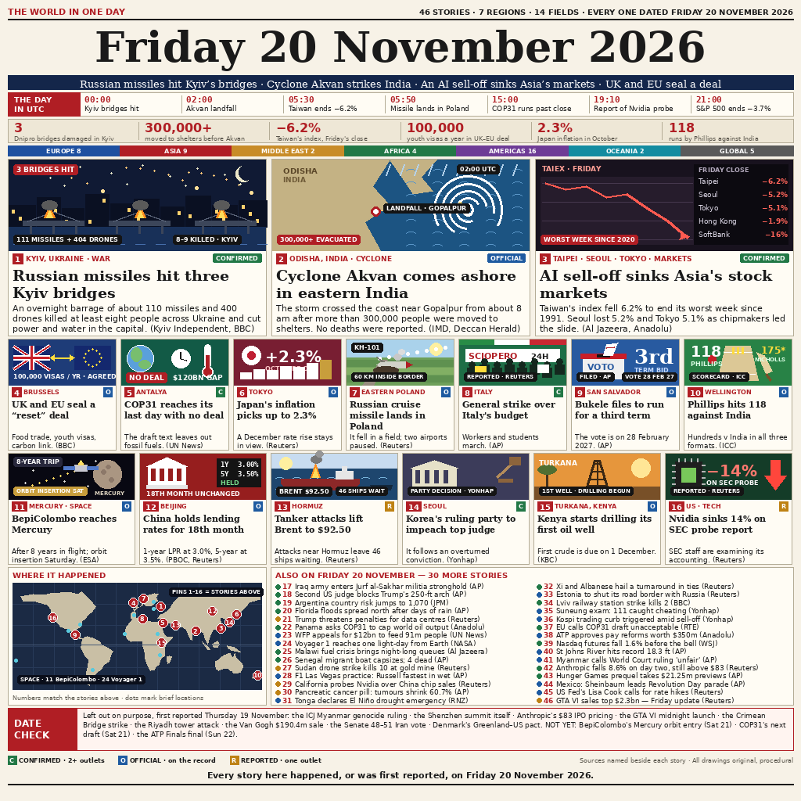

[](https://make.fun/c/news-image-20261120)
[](https://make.fun/c/news-image-20261120/leaderboard)
[](https://make.fun/c/news-image-20261120)

# Friday 20 November 2026 — The World in One Day

A one-page newspaper front page summing up world news from **Friday 20 November 2026**,
built for the [news-image-20261120](https://make.fun/c/news-image-20261120) competition on make.fun.



## What's on the page

- **33 stories, all dated Friday 20 November 2026** — 3 big illustrated leads
  (Kyiv overnight barrage, Cyclone Akvan landfall, Asia AI sell-off), 10 illustrated
  features, and 20 one-line briefs, each with its source in parentheses.
- **Date masthead** naming Friday 20 November 2026, a stat strip, a region strip
  (Europe 7 · Asia 10 · Middle East 3 · Africa 5 · Americas 4 · Oceania 3 · Global 1),
  and a world map with numbered pins 1–13 matching the illustrated stories.
- **DATE CHECK box** listing Thursday 19 November stories deliberately excluded
  (ICJ Myanmar ruling, Shenzhen summit itself, Anthropic IPO pricing, GTA VI midnight
  launch, and more). Friday angles on Thursday events are framed as Friday developments.
- Every illustration is an original flat-vector drawing made procedurally with PIL —
  no external images, no network access.

## Build

```sh
python3 compose.py   # regenerates entry.png (1024x1024, deterministic)
```

`main.ts` (Node 22 stdlib only) validates the PNG — signature, IHDR, size ≤ 1 MiB,
dimensions ≤ 1024×1024 — and copies it to `$MAKEFUN_OUTPUT_DIR` (default `/output`).

## License

MIT — see [LICENSE](LICENSE).
